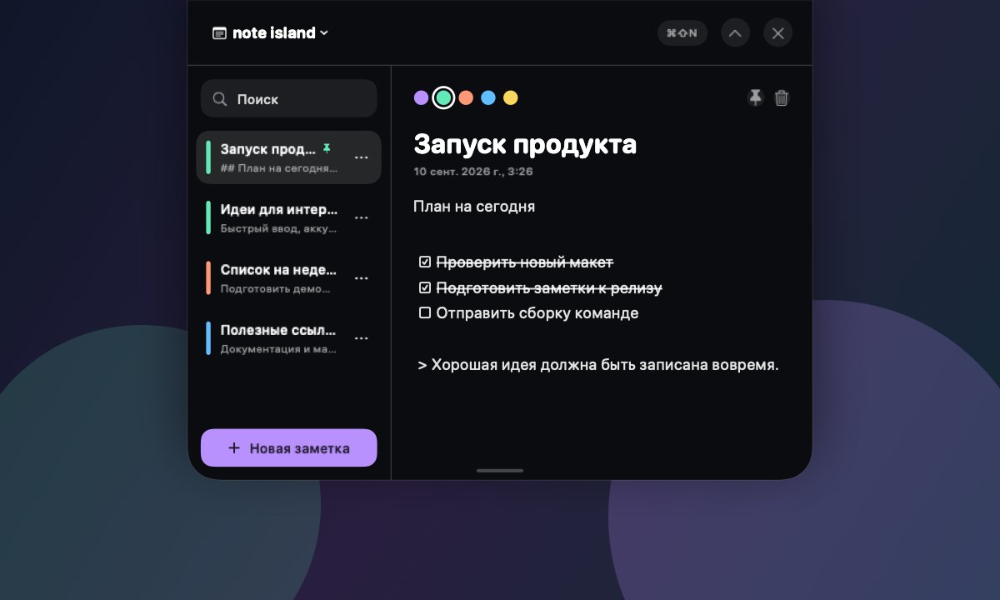
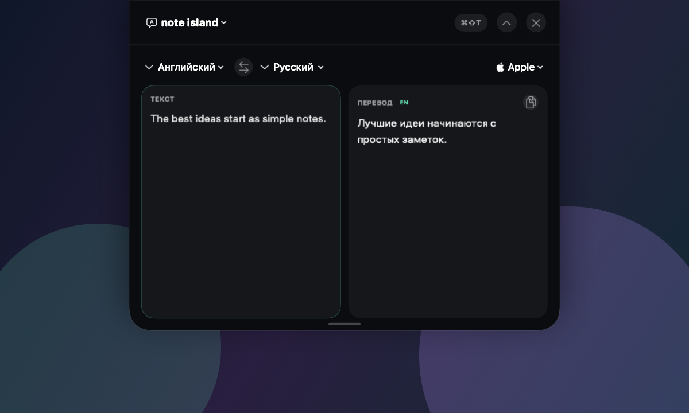
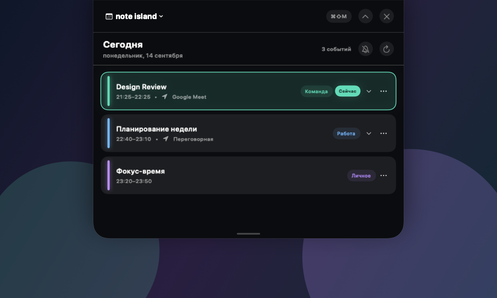
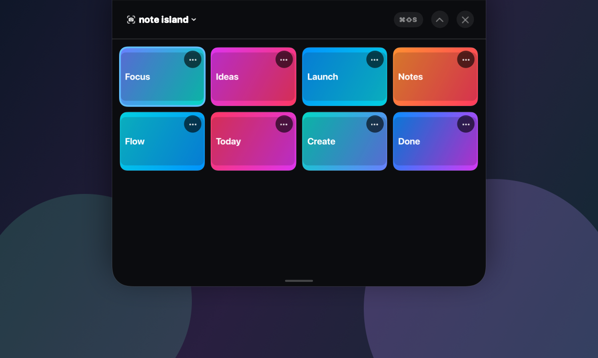

# Note Island

Нативный Note Island для macOS: компактная панель у верхнего края экрана раскрывается в заметки, переводчик, календарь, записи и скриншоты.

## Интерфейс

<p align="center">
  
</p>

<table>
  <tr>
    <td width="50%">
      <strong>Быстрый перевод</strong><br><br>
      
    </td>
    <td width="50%">
      <strong>Встречи на сегодня</strong><br><br>
      
    </td>
  </tr>
  <tr>
    <td colspan="2">
      <strong>История скриншотов</strong><br><br>
      
    </td>
  </tr>
</table>

## Запуск

```bash
git clone https://github.com/raven-ai-esh/note-island.git
cd note-island
swift run NoteIsland
```

Или собрать обычное macOS-приложение для запуска двойным кликом:

```bash
chmod +x build-app.sh
./build-app.sh
open "dist/Note-Island-macOS.zip"
```

Скрипт создаёт локальное приложение и архив `dist/Note-Island-macOS.zip`. Для самостоятельной сборки нужны macOS 15+ и актуальные Xcode Command Line Tools. Если в Keychain есть Apple Development certificate, скрипт использует его; иначе приложение подписывается локальной ad-hoc подписью.

Такая сборка предназначена для запуска на Mac, где она собрана. Публичный готовый `.app` будет опубликован в [Releases](https://github.com/raven-ai-esh/note-island/releases) только после подписи Developer ID Application и нотариального подтверждения Apple.

Горячие клавиши:

- `⌘⇧N` — заметки;
- `⌘⇧T` — переводчик;
- `⌘⇧M` — встречи на сегодня;
- `⌘⇧R` — записи;
- `⌘⇧S` — скриншоты.

Повторное нажатие сочетания активного режима сворачивает Island. Приложение также доступно через иконку заметки в строке меню.

Клик снаружи сворачивает раскрытую панель. Кнопка с булавкой рядом с крестиком закрепляет её: панель остаётся открытой, пока вы не свернёте её вручную. Закрепление запоминается между запусками.

Заметки автоматически сохраняются в `~/Library/Application Support/NoteIsland/notes.json`.

## Возможности

- компактный и раскрытый режимы;
- переключение «Заметки / Переводчик / Встречи / Записи / Скриншоты» по нажатию на `note island`;
- создание, редактирование и удаление заметок;
- поиск по названию и тексту;
- закрепление и цветовые метки;
- локальное JSON-хранилище;
- работа поверх окон и во всех Spaces.

## Записи

Режим «Записи» поддерживает:

- запись системного звука и микрофона через ScreenCaptureKit с экспортом аудио в `.m4a`;
- запись экрана, системного звука и микрофона через ScreenCaptureKit в `.mov`;
- локальный список записей и встроенное воспроизведение через нативный `AVPlayerView`;
- переход к выбранному файлу в Finder.

Файлы сохраняются в `~/Library/Application Support/NoteIsland/Recordings`. Оба режима требуют macOS 15+, разрешений Screen Recording, System Audio Recording и Microphone. Захват работает внутри процесса Note Island: после завершения или падения процесса отдельный recorder не остаётся.

## Скриншоты

Режим «Скриншоты» следит за изображениями в системном буфере обмена и сохраняет собственную историю в `~/Library/Application Support/NoteIsland/Screenshots`. Для скриншота прямо в буфер macOS используйте `⌃⌘⇧3` или `⌃⌘⇧4`.

Доступны миниатюры, копирование, перенос файлов наружу и внутрь через drag-and-drop, удаление в системную Корзину и встроенный редактор Note Island в отдельном полноценном окне. Редактор умеет рисовать, менять цвет и толщину, обрезать, поворачивать, отражать, отменять, сбрасывать и сохранять результат без запуска Preview.

## Переводчик

По умолчанию используется системный **Apple Translation** без API-ключа. На macOS 15+ языковые модели загружаются на устройство при первом переводе и затем доступны локально.

Дополнительно можно выбрать:

- **Google Cloud Translation** — официальный Basic v2 API;
- **DeepL** — официальный API с `prefer_quality_optimized`.

Google Cloud и DeepL требуют собственный API-ключ. Ключ вводится внутри режима переводчика и хранится в macOS Keychain, а не в файлах заметок или `UserDefaults`.

## Встречи

Режим «Встречи» показывает через системный EventKit события на текущий день из календарей, подключённых к Apple Calendar. Кнопка `+` создаёт встречу, а контекстное меню события позволяет изменить или удалить её. Доступны название, календарь, даты и время, режим «Весь день», место, ссылка и описание. Сохранение и удаление сразу записываются в Apple Calendar; дальнейшую синхронизацию с iCloud и другими аккаунтами выполняет macOS. Внешние изменения календаря автоматически обновляют список.

Редактировать можно события в календарях с правом записи. Для повторяющихся встреч меняется или удаляется только выбранное повторение. Удаление требует подтверждения; открытая форма сохраняется до нажатия «Сохранить» или «Отмена».

Кнопка с колокольчиком включает локальные уведомления за 10 минут до ближайших встреч, а кнопка с перечёркнутым колокольчиком оставляет встречи без уведомлений. Режим запоминается; изменение событий в Apple Calendar автоматически перепланирует напоминания. События на весь день не создают уведомлений.

EventKit не предоставляет отдельного read-only разрешения: для чтения существующих событий macOS требует **Full Access**. Запрос появляется только при первом открытии режима встреч. Если доступ отклонён, экран предлагает открыть системные настройки.

## Ограничение платформы

macOS не предоставляет сторонним приложениям системный Dynamic Island API и не позволяет рисовать внутри физического выреза. На MacBook с notch Note Island читает системные `safeAreaInsets` и `auxiliaryTopLeftArea/rightArea`, расширяя безрамочную панель от физического верхнего края как визуальное продолжение выреза. На дисплеях без notch приложение показывает обычную капсулу под строкой меню.

## Лицензия

[MIT](LICENSE)

## Подготовка релиза

В `release/` есть [сценарий сборки ZIP и DMG](release/README.md), контрольные
суммы, проверка содержимого контейнеров и [инструкция установки](release/INSTALL.txt).
Кандидаты предназначены для локальной проверки. Публичные установщики ожидают
Developer ID, нотариальной проверки Apple и приёмки установки на чистом Mac.
Готовится универсальная сборка для Apple Silicon и Intel с macOS 15+.
